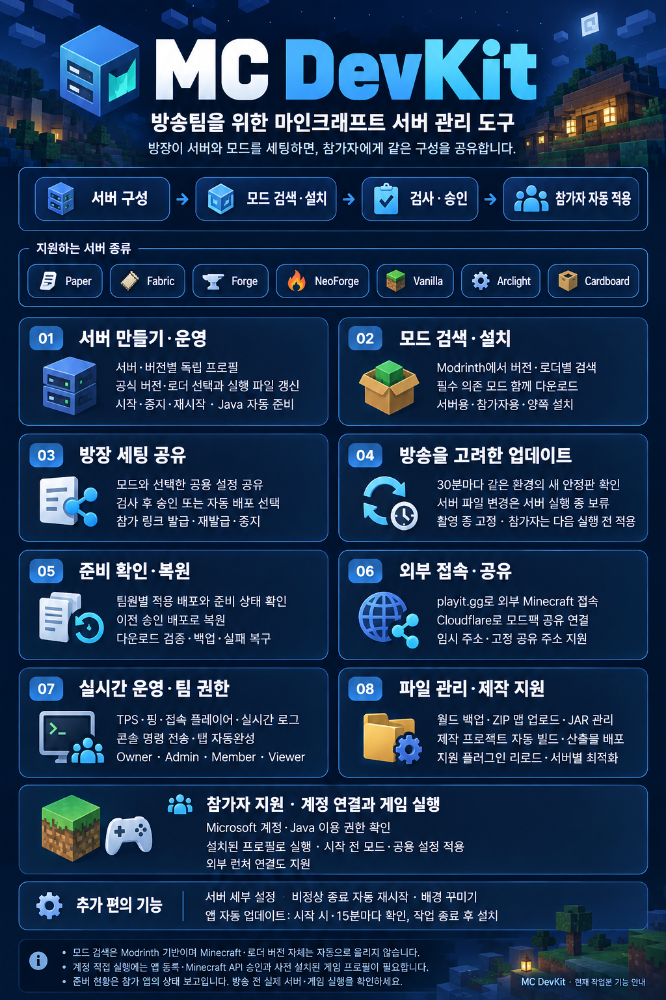

# MC DevKit 1.10.0

방장이 모드를 찾고 서버를 구성한 뒤, 승인한 모드와 공용 설정을 방송팀에 공유하는 흐름을 추가했습니다. MC DevKit은 서버 관리 도구이며, 계정 연결과 게임 직접 실행은 참가자를 위한 보조 기능입니다.

- **모드 검색·다운로드**: Modrinth에서 서버의 Minecraft 버전과 Fabric·Forge·NeoForge 로더에 맞는 버전을 선택합니다. 필수 의존 모드를 함께 확인하고 서버·참가자 양쪽, 서버만, 참가자만 설치할 수 있습니다. 다운로드 파일의 크기와 공개 해시를 검증합니다.
- **호환 모드 자동 업데이트**: 카탈로그로 설치한 모드는 앱 시작 후와 30분마다 같은 Minecraft·로더에 맞는 새 안정 버전을 확인합니다. 서버 실행 중에는 변경을 보류하고, 촬영 모드에서는 구성을 고정합니다. Minecraft·로더 자체나 수동으로 넣은 JAR를 자동으로 올리지는 않습니다.
- **방장 설정 공유**: 변경분과 검사 결과를 확인해 승인하거나, 검사 통과 시 자동 배포를 선택할 수 있습니다. 참가자는 다음 게임 시작 전에 승인된 모드와 지정한 공용 설정을 다운로드·백업·적용합니다. 실행 중인 게임 파일은 교체하지 않습니다.
- **Microsoft 계정 연결·직접 실행**: Microsoft 공식 화면의 기기 코드 로그인으로 Java 이용 권한과 프로필을 확인합니다. 갱신 토큰은 OS 암호화 저장을 사용하며, 연결한 정확한 설치 프로필로 게임을 실행합니다. 외부 런처로 여는 방식도 유지합니다.

## 사용 전 확인

- 모드 검색은 **Modrinth 카탈로그**를 사용합니다. CurseForge 카탈로그/API는 연결하지 않습니다.
- 계정 연결·직접 실행에는 배포자가 등록한 **Microsoft Client ID와 Minecraft API 접근 승인**이 필요합니다. 준비되지 않은 배포본에서는 실제 계정 연결을 완료할 수 없습니다. [계정 설정 안내](../minecraft-account.md)를 참고하세요.
- Minecraft·로더·게임 리소스는 연결한 외부 런처에서 먼저 설치·실행해야 합니다. 지원하지 않는 프로필 형식은 외부 런처로 실행합니다.
- 메타데이터 검사가 실제 실행 호환성을 모두 보장하지는 않습니다. 방송 전 서버와 참가자 게임을 실행해 확인한 뒤 촬영 모드로 고정하세요. [서버 모드 관리 안내](../server-mods.md)

## 검증

자동 테스트 88개와 Electron 화면 동작 검사를 통과했습니다. 서버 실행 중 모드 제거 방지, 다운로드 중 서버 환경 변경 감지, 파일 적용 중 설정 변경 차단도 검사합니다. 계정 인증 테스트는 모의 Microsoft·Xbox·Minecraft 응답으로 수행했으며, 실제 계정 로그인 검증을 완료했다는 의미는 아닙니다.

Windows 설치 파일과 자동 업데이트용 `.blockmap`, `latest.yml`을 함께 제공합니다. 기존 앱은 업데이트를 다운로드한 뒤 재시작 또는 완전 종료 시 설치합니다.
